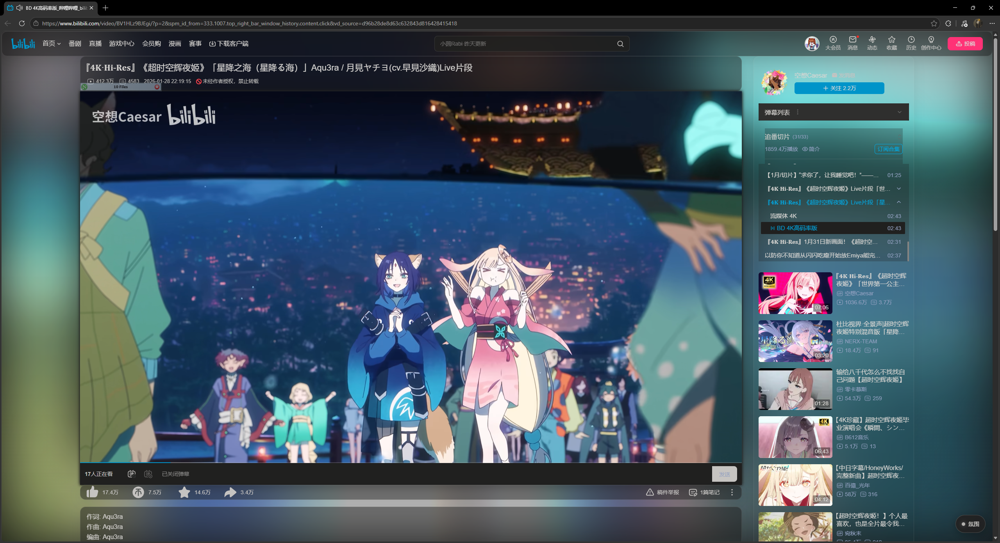

# B站 · 流光毛玻璃

把视频边缘的颜色扩散到页面背景，让顶栏、视频信息和推荐区呈现毛玻璃效果。当前版本 **0.3.0**，支持实时变化与全屏溢光。

## 安装与使用

1. 电脑 Edge / Chrome，或安卓平板 Edge，先安装 Tampermonkey。
2. [点击安装脚本](https://raw.githubusercontent.com/Casper-003/Melchior-1/main/%E5%AE%9E%E9%AA%8C/2026-10-21_B%E7%AB%99%E6%B5%81%E5%85%89%E6%AF%9B%E7%8E%BB%E7%92%83/Files/bilibili-ambient-glass.user.js)。如果没有出现安装界面，可以复制脚本全文，在 Tampermonkey 中新建脚本、粘贴并保存。
3. 打开或刷新B站普通视频播放页；平板使用“桌面版网站”。
4. 点击右下角“氛围”调整强度、范围、柔和程度和运行档位。**范围拉到最右侧即为全屏扩散**。

默认使用均衡档。暂停和切换后台时停止更新；关闭效果后恢复页面样式。设置会自动保存。

## 文件

- [脚本源码](Files/bilibili-ambient-glass.user.js)
- [浏览器测试](Files/tests/browser.cjs)与[本地测试页](Files/tests/fixture.html)

Edge 与 Chrome 共通过 **26 项本地浏览器检查**，包括横屏、宽屏、竖屏的边角覆盖。目标设备为 Galaxy Tab S9；其他设备的性能及B站页面改版后的兼容性仍需实测。番剧、直播和手机版页面暂未适配，部分特殊播放器可能无法生成色光。

以下为B站页面实测预览：

