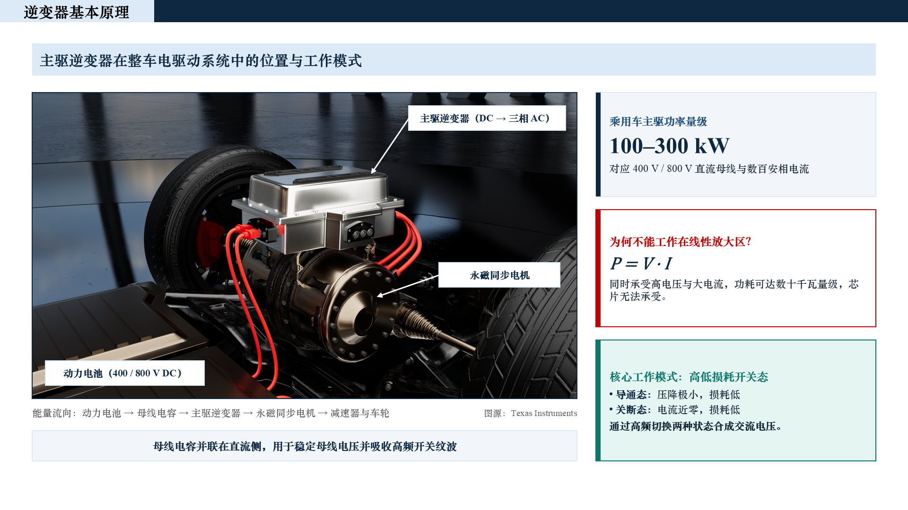
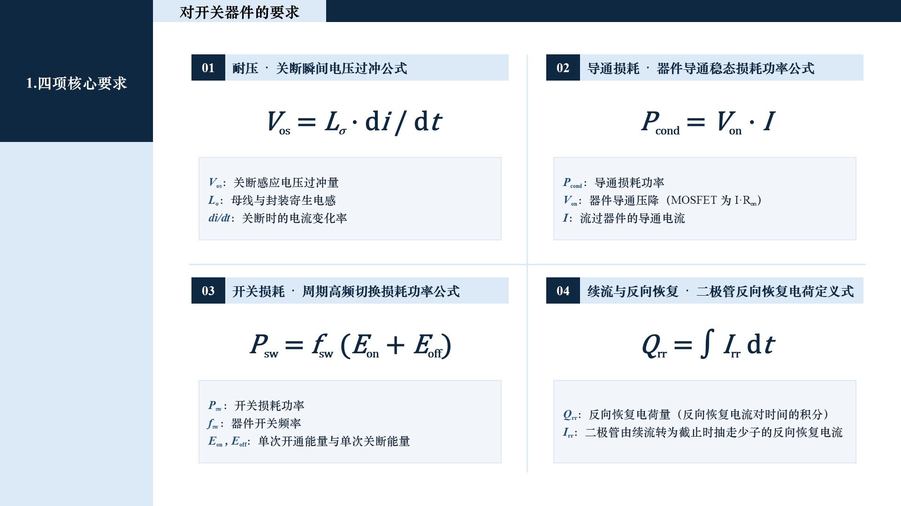
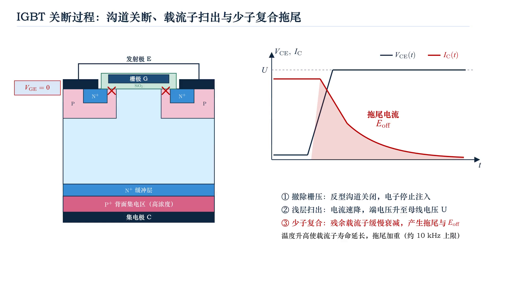
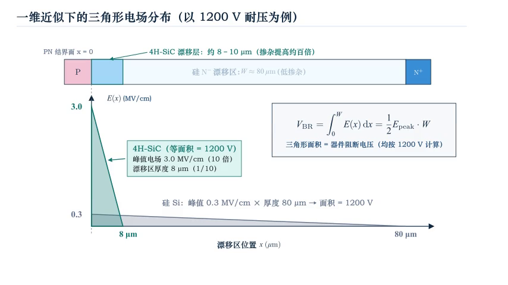
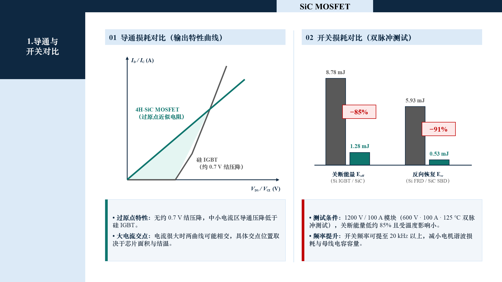
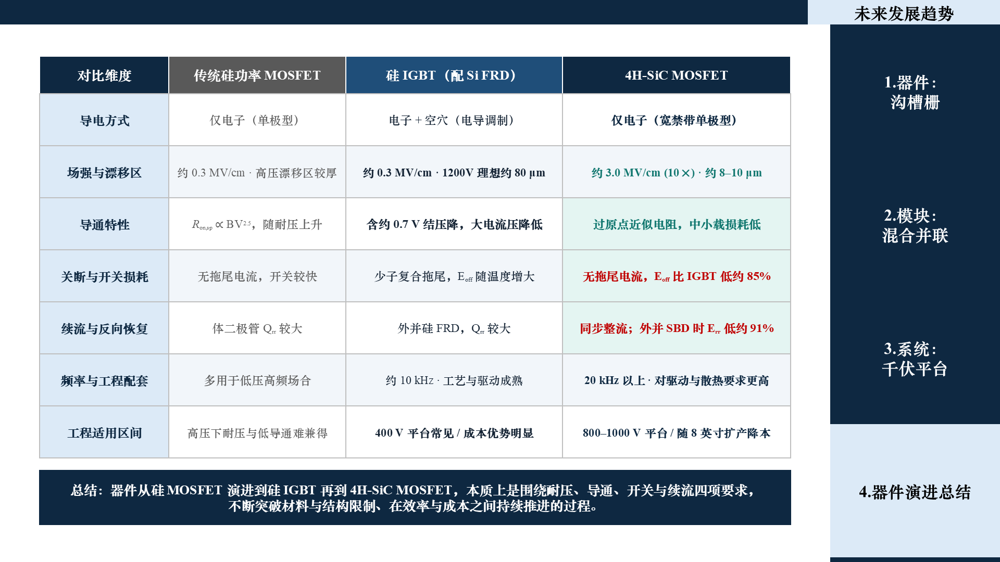

# 先进半导体器件在新能源汽车主驱逆变器的应用

课程：先进半导体器件 · 归档日期：2026-11。

围绕新能源汽车主驱逆变器，从单相 H 桥与 SPWM 逆变原理出发，归纳主驱系统对功率开关器件的四项核心要求，对比传统硅功率 MOSFET、硅 IGBT（配硅 FRD）与 4H-SiC MOSFET 的器件结构、物理机制、实测损耗和量产成本瓶颈，并总结沟槽栅、SiC/IGBT 混合并联与千伏平台三个演进方向。

本目录包含最终 29 页课堂汇报 PPT（内嵌动画视频与格式化演讲者备注）、配套发言稿与排版设计文档、Manim 电路/器件物理动画源码，以及基于 PowerPoint COM 自动化构建与备注注入脚本。

## 汇报结构

| 章节 | 页码 | 核心内容 |
| --- | --- | --- |
| 第一章 · 逆变器基本原理 | Slides 1–12 | 整车电驱动连接关系、线性区与开关态对比、FOC 控制链路、单相 H 桥与感性续流/死区、SPWM 伏秒面积等效与三相全桥 |
| 第二章 · 对开关器件的要求 | Slides 13–14 | 耐压过冲、导通损耗、开关损耗与反向恢复四项指标，以及硅功率 MOSFET 的 $R_{\mathrm{on,sp}} \propto BV^{2.5}$ 局限 |
| 第三章 · 硅 IGBT | Slides 15–18 | 背面 $P^+$ 集电区与电导调制原理，以及约 0.7 V 结压降、关断拖尾电流与外并 FRD 反向恢复三项局限 |
| 第四章 · 4H-SiC MOSFET | Slides 19–24 | 宽禁带材料参数、1200 V 一维三角形电场与薄漂移区、单极导通关断、双脉冲损耗对比、同步整流与长晶切片成本瓶颈 |
| 第五章 · 未来发展趋势与总结 | Slides 25–29 | 沟槽栅元胞、SiC/IGBT 混合并联（小鹏 X9 参考）、千伏平台（1500 V 级器件）、三代器件汇总对比与参考文献 |

## 文档与成品

| 文件 | 说明 |
| --- | --- |
| [新能源汽车主驱逆变器_课堂汇报.pptx](Files/新能源汽车主驱逆变器_课堂汇报.pptx) | 最终 29 页课堂汇报 PPT（16:9，已内嵌动画片段与格式化演讲者备注） |
| [按页发言稿（Markdown）](Docs/新能源汽车主驱逆变器_按页发言稿.md) | 对应 29 页 PPT 的约 15 分钟口播稿，含答问备查与参考文献链接 |
| [润色版发言稿（Markdown）](Docs/新能源汽车主驱逆变器_发言稿_润色版.md) | 10 部分连贯叙述版发言稿，含动画要点与参数核对表 |
| [润色版发言稿（A4 打印 PDF）](Docs/新能源汽车主驱逆变器_发言稿_润色版.pdf) | 由脚本经 HTML + MathML + Chrome Headless 排版生成的 A4 打印版 |
| [PPT 布局动画方案与提示词](Docs/主驱逆变器PPT_布局动画方案与Gemini提示词.md) | 早期 10 页版视觉规范、分镜切片方案与逐页动画时间轴规格 |

## 源码说明

### Manim 动画工程（`Files/manim_inverter/`）

使用 Manim Community Edition 渲染 1080p60 电路与半导体器件物理动画：

| 文件 | 用途 |
| --- | --- |
| [p1_hbridge_scenes.py](Files/manim_inverter/src/p1_hbridge_scenes.py) | 单相 H 桥拓扑、双极性方波与感性电流推导、续流与死区动画（`P1A`–`P1C`） |
| [p2_spwm_motor_scenes.py](Files/manim_inverter/src/p2_spwm_motor_scenes.py) | 双极性 PWM 伏秒平均、正弦包络、SPWM 参数联动与三相永磁同步电机动画（`P2A`–`P2C`） |
| [p3_device_scenes.py](Files/manim_inverter/src/p3_device_scenes.py) | 器件物理动画：`IGBTConductionScene`、`IGBTTurnOffTailScene`、`SiCParamsBarsScene`、`SiCEFieldTriangleScene`、`SiCMOSFETPrincipleScene` |
| [hbridge.py](Files/manim_inverter/src/hbridge.py) | 可复用的单相 H 桥电路组件（含独立反并联续流二极管与开关动画） |
| [physics.py](Files/manim_inverter/src/physics.py) | 确定性物理波形与 RL 周期稳态数值计算 |
| [plot_utils.py](Files/manim_inverter/src/plot_utils.py) | 波形示波器组件、调制 HUD 与跨分镜无缝衔接状态构造 |
| [style.py](Files/manim_inverter/src/style.py) | 统一配色、字体、画布布局锚点与 Times LaTeX 模板 |
| [generate_explosion_sprites.py](Files/manim_inverter/src/generate_explosion_sprites.py) | 生成桥臂直通短路像素爆炸帧素材（已归档于 `assets/explosion/`） |
| [stitch_videos.ps1](Files/manim_inverter/stitch_videos.ps1) / [qa_extract.ps1](Files/manim_inverter/qa_extract.ps1) | FFmpeg 1080p60 分镜拼接与 QA 关键帧抽检脚本 |

### PPT 构建与排版脚本（`Files/ppt_builder/`）

| 文件 | 用途 |
| --- | --- |
| [build_user_style_deck.py](Files/ppt_builder/build_user_style_deck.py) | 通过 Windows PowerPoint COM 构建最终 29 页汇报 PPT、执行规范巡检并导出预览图 |
| [user_style_helpers.py](Files/ppt_builder/user_style_helpers.py) | 最终版 PPT 的版式、顶栏/侧栏导航、富文本上下标与视频嵌入封装 |
| [inject_notes.py](Files/ppt_builder/inject_notes.py) | 解析按页发言稿 Markdown 中的 LaTeX 行内公式，以原生上下标格式写入 PPT 演讲者备注栏 |
| [md_to_pdf.py](Files/ppt_builder/md_to_pdf.py) | 将润色版发言稿 Markdown 转为 MathML HTML 并调用 Chrome Headless 导出 A4 PDF |
| [slice_videos.py](Files/ppt_builder/slice_videos.py) | 将 Manim 整片按汇报节拍切片并补末帧静帧，用于 PPT 逐次点击无缝播放 |
| [build_deck.py](Files/ppt_builder/build_deck.py) / [ppt_helpers.py](Files/ppt_builder/ppt_helpers.py) / [slides_1_to_5.py](Files/ppt_builder/slides_1_to_5.py) / [slides_6_to_10.py](Files/ppt_builder/slides_6_to_10.py) | 早期 10 页全原生形状版 PPT 的自动构建与审计脚本 |

## 运行环境与归档说明

- **动画渲染**：需要 Python、Manim Community Edition、`numpy`、`Pillow`、TeX 发行版与 FFmpeg。
- **PPT 构建与 PDF 生成**：`ppt_builder` 基于 Windows PowerPoint COM（`pywin32`）；PDF 排版依赖 `markdown`、`latex2mathml`、`pymupdf` 与本机 Chrome。脚本内保留了原始本地工作路径，如需复现运行，请按本机环境调整 `ROOT_DIR` 与 FFmpeg 路径。
- **体积控制**：独立渲染的整片 MP4、虚拟环境与中间备份未纳入仓库；汇报所用的器件与原理视频片段已直接嵌入 `新能源汽车主驱逆变器_课堂汇报.pptx` 中。

## 部分页面与动画预览

